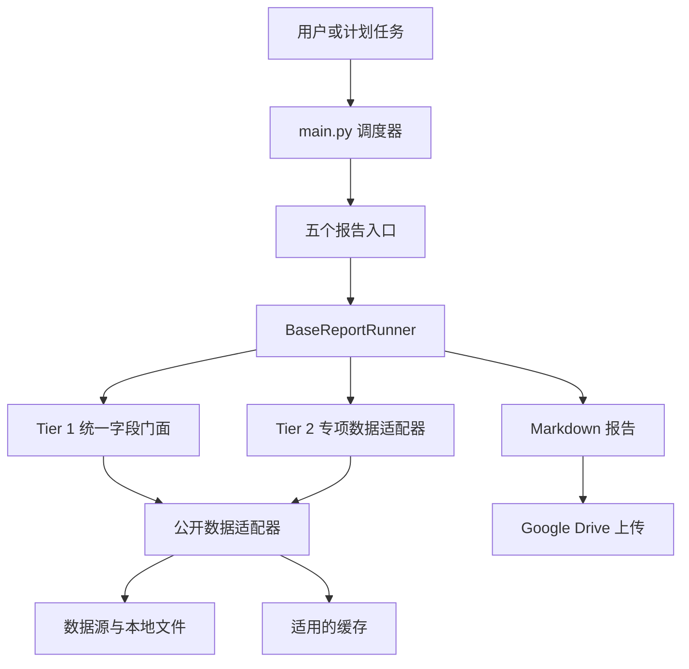

# 项目架构与数据流

本文提供当前主要模块的导航，不重复维护字段数量、来源优先级、交易时段、限流值、并发参数或缓存 TTL。具体行为以运行时代码和契约测试为准；架构原则见 [`ARCHITECTURE_THEORY.md`](ARCHITECTURE_THEORY.md)。

## 执行与数据流

- `main.py` 解析任务并管理报告子进程及退出结果。
- `get_*_report.py` 组织各自的报告和策略；`stock_common/sc_report_runner.py` 提供共享报告生命周期。
- Tier 1 位于 `core/data_provider.py`，负责共享字段合约、来源选择、fallback、单位归一化和逐字段元数据。
- Tier 2 由 `stock_common/` 与 `core/tdx_client.py` 的公开适配器提供报告专用数据。
- 原始客户端、网络控制、缓存和解析由各自适配层所有；生产报告与采集脚本通过公开适配器取数。

## 权威来源

| 问题 | 依据 |
|---|---|
| 数据访问边界、架构原则与可接受偏离 | [`ARCHITECTURE_THEORY.md`](ARCHITECTURE_THEORY.md)、[`DEBT_LEDGER.md`](DEBT_LEDGER.md) |
| 字段身份与逐源状态 | [`field_verification/field_registry.json`](field_verification/field_registry.json)；[`field_dict.md`](field_dict.md) 是生成导航 |
| 字段日期与来源新鲜度 | `core/data_provider.py`、对应适配器和契约测试 |
| 路由、限流、重试、缓存及并发 | 对应运行时代码和测试；采集操作见 [`field_verification/DAILY_RUNBOOK.md`](field_verification/DAILY_RUNBOOK.md) 与 [`../scripts/README.md`](../scripts/README.md) |
| 碰撞报告审阅、候选分析和正式字段裁决 | [`field_verification/COLLISION_REPORT_REVIEW.md`](field_verification/COLLISION_REPORT_REVIEW.md)、[`field_verification/CRACKING_METHODOLOGY.md`](field_verification/CRACKING_METHODOLOGY.md)、[`field_verification/ADJUDICATION_WORKFLOW.md`](field_verification/ADJUDICATION_WORKFLOW.md) |
| Python 验收流程 | [`../AGENTS.md`](../AGENTS.md) §4、[`../tests/README.md`](../tests/README.md) |

ZHB、缓存和数据日期的特殊边界应在相应解析器、测试和每日运行卡核实。字段契约或运行路由变化后，只更新受影响的权威来源与本页必要的稳定导航。
